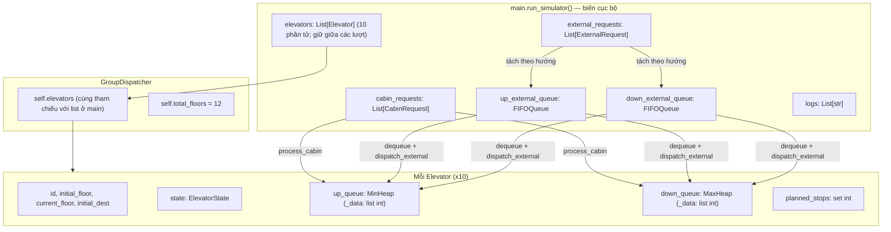

# RUNTIME STATE & STORAGE MAP
## Smart Elevator Dispatch Simulator — CSD203 FA26

Tài liệu này mô tả **mỗi loại dữ liệu** trong quá trình chạy (trạng thái thang, Hall Request, Cabin Request, điểm dừng, log, lộ trình): **lưu ở đâu, bằng cấu trúc gì, tồn tại bao lâu, hàm nào thay đổi nó**. Mọi bảng số liệu ở Mục 3 lấy trực tiếp từ một lần chạy thật của source code.

---

## 1. Tổng quan



Không có biến toàn cục, file hay database: **trạng thái thang và yêu cầu nằm trong RAM**. Danh sách thang tồn tại suốt vòng lặp `run_simulator()`; mỗi lượt tạo yêu cầu và hàng đợi mới. Chọn tiếp tục giữ nguyên vị trí thang, còn chọn đặt lại tạo 10 đối tượng thang mới.

---

## 2. Danh mục chi tiết từng nơi lưu trữ

### 2.1. Trạng thái thang máy: thuộc tính của `Elevator` (`src/models.py`)

| Thuộc tính | Kiểu | Gán ở đâu | Có thay đổi sau khởi tạo? | Ý nghĩa |
|---|---|---|---|---|
| `id` | `int` (1..10) | `__init__` | Không | Định danh; `GroupDispatcher.get_elevator(id)` trả về `elevators[id-1]` |
| `initial_floor` | `int` | `__init__` | Không | Tầng nhập ban đầu; không đổi khi thang chạy |
| `current_floor` | `int` | `__init__`, từng bước trong `display_results` | **Có** | Vị trí hiện tại; dùng tính `dist`, chọn heap và làm điểm bắt đầu lộ trình kế tiếp |
| `initial_dest` | `Optional[int]` | `__init__`, `finish_route` | Được xóa khi lượt chạy hoàn tất | Đích ban đầu nếu input `f:d`; `None` nếu IDLE hoặc đã hoàn tất |
| `state` | `ElevatorState` | `__init__`, `add_stop`, `finish_route` | `IDLE → MOVING_*` khi nhận điểm dừng; trở về `IDLE` khi phục vụ xong lượt | Đầu vào của hàm chi phí 3-Tier và hướng quét chính của LOOK |
| `up_queue` | `MinHeap` | `__init__`, `add_stop`, `finish_route` | Điểm dừng được thêm khi điều phối và xóa khi hoàn thành lượt | Tầng dừng xếp vào chiều lên |
| `down_queue` | `MaxHeap` | `__init__`, `add_stop`, `finish_route` | Điểm dừng được thêm khi điều phối và xóa khi hoàn thành lượt | Tầng dừng xếp vào chiều xuống |
| `planned_stops` | `set[int]` | `__init__`, `add_stop`, `finish_route` | Làm rỗng khi lượt chạy kết thúc | Hợp của 2 heap; dùng trong `has_movement()` |

**Khởi tạo `state`** (`Elevator.__init__`):
- Input `f` → `IDLE`, hai heap rỗng, `planned_stops` rỗng.
- Input `f:d`, `d > f` → `MOVING_UP`, `up_queue = [d]`, `planned_stops = {d}`.
- Input `f:d`, `d < f` → `MOVING_DOWN`, `down_queue = [d]`, `planned_stops = {d}`.
- Input `f:f` bị `parse_elevators_input` chặn bằng `ValueError` trước khi tạo object.

**Cập nhật `state`** (`Elevator.add_stop`, chỉ khi đang `IDLE` và stop được thêm thành công):
- `floor > current_floor` → `MOVING_UP`
- `floor < current_floor` → `MOVING_DOWN`
- `floor == current_floor` (chỉ xảy ra với Hall call có hướng) → theo `dir_intent`

> **Lưu ý:** `state` biểu diễn **hướng di chuyển vật lý tới điểm dừng đầu tiên**, không phải hướng khách muốn đi. Ví dụ ở Mục 3: thang #8 ở tầng 9 (IDLE) nhận `10D` thì `state = MOVING_UP` (phải lên tầng 10), còn tầng 10 được lưu trong `down_queue` (khách muốn đi xuống).

### 2.2. Hall Request (External): `ExternalRequest` → `FIFOQueue` → heap

| Giai đoạn | Nơi lưu | Cấu trúc |
|---|---|---|
| Sau khi parse | `external_requests` (biến cục bộ trong `main`) | `List[ExternalRequest]` `{floor, direction}`, giữ thứ tự nhập |
| Trước điều phối | `up_external_queue`, `down_external_queue` | 2 `FIFOQueue`, tách theo `direction` |
| Sau khi gán | Chỉ còn `req.floor` (int) trong heap của thang được chọn. **Hướng** được mã hóa gián tiếp qua việc tầng nằm ở `up_queue` hay `down_queue`. Object `ExternalRequest` không được giữ lại | `int` trong `_data` của heap |
| Dấu vết | 1 dòng trong `logs` | `"External Request 6U -> Assigned to Elevator #3 (Cost: 1)"` |

**Cài đặt `FIFOQueue`** (`src/data_structures.py`):
- `_items: list` + `_head: int`. **Không có `_tail`**: cuối hàng chính là cuối list.
- `enqueue`: `_items.append(item)`, O(1) khấu hao.
- `dequeue`: trả `_items[_head]`, `_head += 1`; phần tử chưa bị xóa vật lý ngay.
- Compaction: khi `_head > 50` **và** `_head > len(_items) // 2` thì `_items = _items[_head:]`, `_head = 0`.
- `is_empty`: `_head >= len(_items)`; `__len__`: `len(_items) - _head`.

**Thứ tự xử lý**: `run_dispatch` xử lý hết `up_external_queue` rồi mới tới `down_external_queue`. FIFO được bảo đảm **trong từng hướng**, không phải theo thứ tự nhập toàn cục giữa hai hướng.

### 2.3. Cabin Request: `CabinRequest` → heap của đúng thang đó

| Giai đoạn | Nơi lưu | Cấu trúc |
|---|---|---|
| Sau khi parse | `cabin_requests` (biến cục bộ trong `main`) | `List[CabinRequest]` `{elevator_id, target_floor}`. Không qua Queue trung gian |
| Sau `process_cabin` | `target_floor` trong `up_queue` hoặc `down_queue` của `elevators[elevator_id-1]` và trong `planned_stops` | `int` |
| Dấu vết | 1 dòng trong `logs` (`will stop at Floor X` hoặc `ignored ... (Already at floor / Duplicate)`) | `str` |

`process_cabin` gọi `add_stop(target_floor)` với `dir_intent = Direction.NONE`, nên heap được chọn theo vị trí tầng:
- `target > current_floor` → `up_queue`; `target < current_floor` → `down_queue`.
- `target == current_floor`: thang IDLE thì **bỏ qua** (trả về `False`); thang đang chạy thì đưa vào heap cùng chiều với `state`.

### 2.4. Điểm dừng: bên trong `MinHeap` / `MaxHeap`

- Lưu trong `_data: list[int]`, là cây nhị phân hoàn chỉnh biểu diễn bằng mảng (cha `i`, con `2i+1`, `2i+2`).
- `insert` → append + `_heapify_up`: O(log k).
- `contains(val)` → `val in _data`: **duyệt tuyến tính O(k)**, k ≤ 12.
- `copy()` → heap mới với `list(_data)`.
- `extract_min` / `extract_max` → **chỉ được gọi trên bản copy** trong `generate_route`; heap gốc không bao giờ bị rút.

**Chống trùng lặp** được thực hiện **theo từng heap** bằng `contains()`, không dùng `planned_stops`. Nhờ vậy một tầng có thể nằm ở **cả hai** heap (ví dụ đón khách UP và đón khách DOWN ở cùng tầng); khi đó `planned_stops` chỉ chứa tầng đó một lần.

### 2.5. Dữ liệu tạm khi sinh lộ trình (`Elevator.generate_route`)

Tất cả là **biến cục bộ**, mất đi khi hàm trả về:

| Biến | Kiểu | Nội dung |
|---|---|---|
| `up_copy`, `down_copy` | `MinHeap`, `MaxHeap` | Bản sao để extract |
| `up_stops` | `list[int]`, tăng dần | Kết quả `extract_min` liên tục |
| `down_stops` | `list[int]`, giảm dần | Kết quả `extract_max` liên tục |
| `primary_dir` | `ElevatorState` | = `self.state`; nếu IDLE thì chọn theo tầng gần nhất |
| `phase1`, `phase2`, `phase3`, `all_stops` | `list[int]` | 3 pha quét đơn điệu |
| `route` | `list[int]` | `[current_floor, ...]`, bỏ tầng trùng liên tiếp; **giá trị trả về duy nhất** |

`route` không được lưu vào `Elevator`; `display_results` gọi hàm để in và mô phỏng. Sau mỗi chặng, `current_floor` được cập nhật tới tầng dừng tiếp theo; kết thúc lượt, `finish_route()` xóa các điểm dừng đã phục vụ và đặt thang về `IDLE`. Vì vậy lộ trình batch kế tiếp bắt đầu từ `current_floor`.

### 2.6. Vòng đời các lượt chạy

- Lượt đầu tiên nhận cấu hình ban đầu cho 10 thang như trước.
- Sau mỗi lượt, lựa chọn **1** giữ nguyên các đối tượng thang và vị trí cuối cùng; lựa chọn **2** nhập cấu hình mới và khởi tạo lại trạng thái của cả 10 thang.
- Mỗi lượt tạo mới các `FIFOQueue` và danh sách yêu cầu; yêu cầu đã điều phối không tồn tại sang lượt tiếp theo.
- EOF tại menu kết thúc chương trình bình thường.

### 2.7. Log điều phối

`logs: List[str]` được tạo trong `GroupDispatcher.run_dispatch`, trả về cho `main` và in trong `display_results`. Thứ tự: tất cả Cabin → External UP → External DOWN.

---

## 3. Vòng đời dữ liệu qua 5 giai đoạn (trace thực tế)

Input:
```
E> 1 3 5:10 8:2 4 6 7 9 11 12
X> 6U 3D 10D 6D
C> 1:12 3:1 4:1 4:4
```

### Giai đoạn 1: Parse → objects
```
external_requests = [External(6U), External(3D), External(10D), External(6D)]
cabin_requests    = [Cabin(E#1->12), Cabin(E#3->1), Cabin(E#4->1), Cabin(E#4->4)]
```

### Giai đoạn 2: Khởi tạo Elevator + tách Queue

| Thang | cur | state | up_queue._data | down_queue._data | planned_stops |
|---|---|---|---|---|---|
| #1 | 1 | IDLE | [] | [] | {} |
| #2 | 3 | IDLE | [] | [] | {} |
| #3 | 5 | MOVING_UP | [10] | [] | {10} |
| #4 | 8 | MOVING_DOWN | [] | [2] | {2} |
| #5–#10 | 4, 6, 7, 9, 11, 12 | IDLE | [] | [] | {} |

```
up_external_queue._items   = [6U]            _head = 0
down_external_queue._items = [3D, 10D, 6D]   _head = 0
```

### Giai đoạn 3: Nạp Cabin Request (trước External)

| Cabin | Kết quả | Heap đích | Lý do |
|---|---|---|---|
| E#1→12 | added | up_queue | 12 > 1; state IDLE → **MOVING_UP** |
| E#3→1 | added | down_queue | 1 < 5 (state vẫn MOVING_UP) |
| E#4→1 | added | down_queue | 1 < 8 |
| E#4→4 | added | down_queue | 4 < 8 (thang #4 bấm tầng 4, hợp lệ) |

### Giai đoạn 4: Điều phối External (UP queue trước, DOWN queue sau)

| Request | Cost của #1..#10 | Chọn | Heap đích | Ghi chú |
|---|---|---|---|---|
| 6U | [5, 15, **1**, 26, 14, 12, 13, 15, 17, 18] | #3 | up_queue | Tier 1: MOVING_UP, 5 ≤ 6 |
| 3D | [26, 12, 26, **5**, 13, 15, 16, 18, 20, 21] | #4 | down_queue | Tier 1: MOVING_DOWN, 8 ≥ 3 |
| 10D | [33, 19, 29, 26, 18, 16, 15, **13**, 13, 14] | #8 | down_queue | Tier 2, hòa với #9 → chọn ID nhỏ hơn; #8 IDLE → **MOVING_UP** |
| 6D | [29, 15, 25, **2**, 14, 12, 13, 27, 17, 18] | #4 | down_queue | Tier 1 |

Sau khi dequeue hết: `up_external_queue._items = [External(6U)]`, `_head = 1`, `len = 0`. Object vẫn còn trong list (chưa tới ngưỡng compaction) nhưng hàng đợi đã rỗng về mặt logic.

Trạng thái sau giai đoạn 4:

| Thang | state | up_queue._data | down_queue._data | planned_stops |
|---|---|---|---|---|
| #1 | MOVING_UP | [12] | [] | {12} |
| #3 | MOVING_UP | [6, 10] | [1] | {1, 6, 10} |
| #4 | MOVING_DOWN | [] | [6, 4, 2, 1, 3] | {1, 2, 3, 4, 6} |
| #8 | MOVING_UP | [] | [10] | {10} |
| Còn lại | IDLE | [] | [] | {} |

`[6, 4, 2, 1, 3]` là thứ tự mảng thật của MaxHeap (gốc 6 lớn nhất), **không phải** mảng đã sắp xếp.

### Giai đoạn 5: Sinh lộ trình (không làm thay đổi dữ liệu gốc)
```
E#1: 1 -> 12
E#3: 5 -> 6 -> 10 -> 1
E#4: 8 -> 6 -> 4 -> 3 -> 2 -> 1
E#8: 9 -> 10
Các thang còn lại: IDLE (No movement)
```
Kiểm tra lại heap, state, `planned_stops` sau `generate_route()`: **giống hệt giai đoạn 4**.

---

## 4. Ghi chú đối chiếu tài liệu

- Tên thuộc tính heap của `Elevator` là **`up_queue` / `down_queue`**. `up_stops` / `down_stops` chỉ là list cục bộ trong `generate_route`.
- **`planned_stops` không dùng để chống trùng.** Chống trùng được thực hiện theo từng heap bằng `contains()`. Dùng một set chung để chống trùng là lỗi đã được ghi nhận và sửa (README Mục VIII.B, Lỗi 2).
- "Đảo chiều LOOK" chỉ xảy ra **khi sắp xếp lộ trình** (phase 2/3), không được ghi vào thuộc tính `state`.
